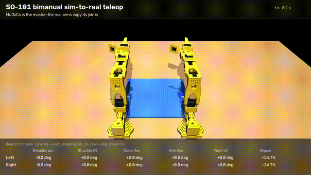

# SO-101 bimanual: simulation is the master, real arms follow

One application: two SO-101 arms in MuJoCo plus a control panel. You move the simulated arms;
the physical arms (COM7 = left, COM9 = right) reproduce the simulated joint positions.
No webcam or MediaPipe is used.



▶ **[Demo video (MP4)](docs/media/demo.mp4)** · 📘 **[Getting started guide](docs/GETTING_STARTED.md)** · 📄 **[Project report](docs/REPORT.md)**

## Quick start

```bash
pip install -r requirements.txt
python sim_teleop.py                    # simulation only (safe default)
python sim_teleop.py --mock-robots      # rehearse the real-arm workflow without hardware
python sim_teleop.py --left-port /dev/ttyACM0 --right-port /dev/ttyACM1   # real arms (Linux)
```

Then in the control panel: **K** connect → **V** verify mapping → **ENTER** follow → **F** fold. **Esc** = emergency stop.
Full step-by-step instructions are in [docs/GETTING_STARTED.md](docs/GETTING_STARTED.md).

## Files

| File | Role |
|---|---|
| `sim_teleop.py` | Main app: MuJoCo scene (2 arms, table, optional cloth), main loop, safety actions |
| `simulation_controller.py` | Joint commands + control panel (keyboard, sliders, buttons, status banner) |
| `robot_sync.py` | One background thread per arm: sim pose -> limits -> speed limit -> motors; e-stop, pause, faults |
| `real_robot_controller.py` | LeRobot SO-101 follower wrapper (your existing calibration) + mock arm for testing |
| `motion_sequence.py` | Teach & replay: record waypoints (P), play them back smoothly (O); saved in `fold_tshirt.json` |
| `joint_mapping.py` | Sim radians <-> real degrees, direction per joint, gripper scale, calibrated limits |
| `tools/record_demo.py` | Renders the demo video offscreen (same scene + replay player as the app) |
| `docs/` | Getting-started guide, project report, demo video |
| `robotstudio_so101/` | SO-101 model from MuJoCo Menagerie (Apache-2.0) |

`hand_teleop_bimanual.py` (webcam) is not used by this app and was not changed.

## Mapping (verified against the LeRobot source)
- Real body joints: degrees, 0 = middle of each joint's calibrated range. Sim: radians, 0 = middle of range.
- `real_deg = DIRECTION * degrees(sim_rad) + OFFSET_DEG`. All joints are +1 (shoulder lift was -1 until
  real-arm testing showed it mirrored on both arms). Edit `DIRECTION` in `joint_mapping.py` if Verify mode shows a mirrored joint.
- Gripper: sim -0.17..1.75 rad -> real 0..100 (100 = open). `GRIPPER_INVERT` flips one arm if needed.
- Limits: read from each arm's calibration at connect (half-range minus 3 deg margin).

## Teach & replay (e.g. folding a t-shirt)
Record the fold once by moving the REAL arms by hand, then replay it as often as you like.
1. K (connect), V (verify: torque off, the sim mirrors the real arms). Support the arms.
2. Put both arms in the first key pose of the fold, press P. Repeat for every key pose
   (approach above the corners, go down, close grippers, lift, carry over, lower, open, retreat).
   Record a pose before AND after each gripper close/open so the gripper moves while the arm is still.
   U deletes the last waypoint. Waypoints are saved instantly to `fold_tshirt.json`.
3. V again (torque on, holding). Press O with real following OFF to preview in the sim only.
4. Press the green FOLD T-SHIRT button (or F). If the arms are connected but not following, it first asks to enable
   them (YES = no jump), then folds. While folding the button reads STOP FOLD. SPACE pauses, ESC = e-stop.
   (ENTER + O does the same in two steps.)
- `--play-speed 30` (deg/s, fastest joint) sets the speed; `--sequence other.json` keeps several motions.
- Hold time per waypoint (`"hold"`, default 0.4 s) can be edited in the JSON, e.g. longer after closing a gripper.
- Playback starts from wherever the arms are, so the first move goes to waypoint 1.

## Safety
- Starts in SIMULATION ONLY. Real arms are never connected or moved automatically.
- Connecting (K) holds the arms' current pose: torque always comes on with goal = present position.
- Following needs ENTER + confirmation. YES first snaps the sim to the real pose, so nothing moves on enable.
- Real arms copy the sim's actual joint positions, low-pass filtered, max 60 deg/s (gripper 120 %/s),
  clamped to calibrated limits. Motor I/O runs in background threads, so it never blocks rendering.
- ESC = emergency stop (panel or 3D window): stops all commands at once; arms hold. Re-enable needs ENTER again.
- SPACE pauses: sim frozen, real arms hold.
- A communication error puts that arm in FAULT (shown in red) and stops commands to it. K reconnects it.
- Quitting disconnects the arms and LeRobot turns torque off, so support the arms first.

## Calibration backup
`calibration/` holds copies of the LeRobot calibration files used with this app (right shoulder lift re-recorded,
848..3116). To restore: copy them to `~/.cache/huggingface/lerobot/calibration/robots/so_follower/`.
