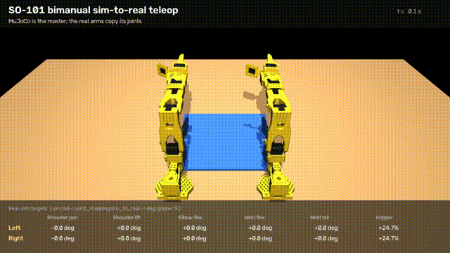

# SO-101 Bimanual Sim-to-Real Teleoperation — Project Report

**Repository:** `so101-sim-teleop` · **Stack:** Python 3.12, MuJoCo 4.0, LeRobot 0.7 (Feetech STS3215 bus), Tkinter
**Demo:** [`docs/media/demo.mp4`](media/demo.mp4)



---

## 1. Goal

Control two physical SO-101 follower arms by moving their **digital twins in MuJoCo**, instead of a
leader arm or a webcam hand tracker. The simulation is the single source of truth. The real arms only reproduce the
simulated joint positions, and only after an explicit, confirmed hand-over. The concrete target task is
**folding a t-shirt** with both arms. The fold is taught once by hand and then replayed on demand.

Design priorities, in order:

1. **Safety.** Nothing physical ever moves unless the operator asked for it, and never with a jump.
2. **Correct mapping** between simulation radians and the real arms' calibrated degrees.
3. **A responsive UI.** Motor I/O must never stall rendering or physics.
4. **Repeatability.** Record a task once and replay it identically.

## 2. System architecture

```
 keyboard / sliders / mouse drag / Player (replay)
                    │
                    ▼
      JointCommands (sim radians, clamped)        simulation_controller.py
                    │  ctrl
                    ▼
     MuJoCo: 2 × SO-101 + table + cloth           sim_teleop.py  (physics + rendering, main thread)
                    │  actual qpos, low-pass α = 0.35
                    ▼
     joint_mapping.sim_to_real  (rad → deg / %)    joint_mapping.py
                    │
        ┌───────────┴───────────┐
        ▼                       ▼
  ArmSync "Left" thread   ArmSync "Right" thread   robot_sync.py  (30 Hz each)
  clamp → rate-limit →    clamp → rate-limit →
  Goal_Position           Goal_Position
        │                       │
   RealArm / MockArm       RealArm / MockArm       real_robot_controller.py (LeRobot SO101Follower)
```

| Module | Responsibility |
|---|---|
| `sim_teleop.py` | Builds the scene with `MjSpec`, attaching the Menagerie SO-101 twice with `left_`/`right_` prefixes and adding a 14×14 `flexcomp` cloth. Runs the main loop and the safety actions. |
| `simulation_controller.py` | `JointCommands` (one source of truth for the sim targets) and the Tk control panel (keys, sliders, buttons, status banner). |
| `robot_sync.py` | One thread per arm that owns its serial port. States: `DISCONNECTED → CONNECTING → HOLDING ⇄ VERIFY / FOLLOWING`, plus `FAULT`. Latched e-stop and pause events. |
| `real_robot_controller.py` | LeRobot follower wrapper with *safe torque-enable*, plus `MockArm` for hardware-free testing. |
| `joint_mapping.py` | Units, direction, offset, gripper scaling and calibrated limits. |
| `motion_sequence.py` | Teach and replay: JSON waypoints and a smoothstep `Player`. |
| `recalibrate_joint.py` | Re-records the range of one joint without touching the others (keeps a backup). |
| `tools/record_demo.py` | Offscreen renderer that produces the demo video from the same `Sim` and `Player`. |

## 3. Key technical decisions

### 3.1 Joint mapping (checked against the LeRobot source)

* **Sim:** radians, 0 = middle of each joint's range (Menagerie `so101_new_calib`).
* **Real:** LeRobot with `use_degrees=True` gives `(raw − mid_of_calibrated_range) · 360 / 4095`, so 0 is also mid-range.
* So the body joints use `real_deg = DIRECTION · deg(sim_rad) + OFFSET_DEG`. No per-joint scale factor is needed.
* **Gripper:** sim −0.1745 to 1.7453 rad maps linearly to real 0–100 (100 = open). `GRIPPER_INVERT` handles an arm with the opposite sign.
* **Limits** come from each arm's own calibration at connect time: ± half the range minus a 3° margin.
* `real_to_sim` is the exact inverse. The round-trip error measured in testing was 0.0 rad.

**Finding from hardware testing:** `shoulder_lift` had been set to `DIRECTION = −1`, inherited from the earlier
webcam mapping. Verify mode showed it was mirrored on **both** arms, so all joints are now `+1`.
The right arm's shoulder-lift range was also re-recorded with `recalibrate_joint.py` (848–3116 ticks).

### 3.2 Safety model

| Hazard | Mitigation |
|---|---|
| The arm jumps when torque is enabled (Feetech servos drive to a stale `Goal_Position`) | `enable_torque` is wrapped so it copies `Present_Position → Goal_Position` first. Torque *always* comes on holding the current pose. |
| The sim and the real arm disagree when following is enabled | An `ENTER` confirmation dialog shows the max difference. **YES** snaps the sim to the measured real pose, so the enable causes zero motion. |
| Fast or oscillating commands | The arms follow the sim's *actual* `qpos` (not the command), low-pass filtered, rate-limited to 60 °/s (gripper 120 %/s), with a 0.05 deadband. |
| Out-of-range commands | Clamped to the calibrated limits minus 3°. |
| Operator panic | `Esc` (panel or 3D window) is a latched e-stop: all writes stop and the arms hold. Re-enabling needs `ENTER` again. Closing the 3D window also triggers it. |
| Serial error / unplugged cable | That arm goes to `FAULT` and gets no further writes. The other arm is unaffected (separate threads). |
| Startup surprises | The app starts in simulation only and never connects automatically. |

### 3.3 Real-time behaviour

Rendering and physics run on the Tk main thread (5 ms tick, sim clock tied to wall-clock time with catch-up capped at 0.1 s).
Each arm's bus I/O runs in its own `ArmSync` thread at 30 Hz and receives targets through a lock-protected slot.
A slow or failing arm therefore cannot freeze the UI or the other arm.

### 3.4 Teach and replay

* **Teach:** in Verify mode (torque off) the sim mirrors the real arms, and `P` stores the current pose of *both* arms as a waypoint.
  Teaching with the physical arms captures poses that are actually reachable and collision-free on the real table.
* **Replay:** `Player` interpolates from the *current* pose through each waypoint with a smoothstep profile (zero velocity at every
  waypoint). Each segment's duration is set by its largest joint change at `--play-speed` (default 30 °/s, minimum 0.5 s),
  and the gripper moves at 80 %/s. A per-waypoint `hold` (default 0.4 s) lets the gripper settle.
* **Cloth grasp in sim:** when a gripper closes below 12 %, up to 3 cloth vertices within 3 cm of the gripper frame are
  attached with `connect` equalities. Above 20 % they are released, which gives hysteresis against chatter.

## 4. Verification

| Test | Method | Result |
|---|---|---|
| Sim ↔ real mapping round trip | `real_to_sim(sim_to_real(q))`, all joints | max error 0.0 rad ✅ |
| Connect holds pose | `SyncManager` + `MockArm`, `connect()` | both arms `HOLDING` ✅ |
| Following + rate limit | `enable_sync()`, step target | both `FOLLOWING`, motion capped at 60 °/s ✅ |
| E-stop latch | `emergency_stop()` while following | both arms fall back to `HOLDING`, writes stop ✅ |
| Direction per joint | Verify mode on the real arms, joint by joint | shoulder_lift was mirrored → fixed to +1 ✅ |
| End-to-end render | `tools/record_demo.py` (offscreen EGL) | 34.8 s, 1280×720 video ✅ |

## 5. Demo video

[`docs/media/demo.mp4`](media/demo.mp4) (≈35 s, rendered offscreen with `tools/record_demo.py`):

1. **0–9 s:** a scene overview orbiting the two arms and the cloth.
2. **9–23 s:** a joint tour in *Both* mode (pan and wrist roll mirrored on the right arm), then the gripper.
3. **23–31 s:** a replay of the taught `fold_tshirt.json` through the same `Player` the **FOLD T-SHIRT** button uses.
4. **The overlay** shows, live, the real-arm targets `sim_to_real` would send (degrees, gripper %).

## 6. Status and limitations

* **The t-shirt fold is not fully taught yet.** `fold_tshirt.json` currently holds 3 test waypoints (two identical
  poses, then neutral). The full fold needs ~10–16 waypoints recorded with the procedure in [GETTING_STARTED.md §6](GETTING_STARTED.md#6-teach-and-replay-a-task-t-shirt-fold).
* **Replay is open-loop.** There is no vision feedback, so the shirt must be placed in the same spot each time.
* **The cloth model is approximate.** It is a 14×14 flex grid, and the grasp is a kinematic weld, not friction. It is good for rehearsal, not for predicting fold quality.
* **There is no collision check between the two real arms.** The sim shows collisions, but the sync layer does not block them.
  Keep the 30 cm base spacing in the sim equal to the real setup (`--spacing`).
* Default ports are Windows (`COM7`/`COM9`). On Linux, pass `--left-port` / `--right-port`.

## 7. Next steps

1. Teach the full fold on the real arms and tune the holds and `--play-speed`.
2. Add a self-collision check (MuJoCo contacts between `left_*` and `right_*`) that pauses following.
3. Locate the shirt with a fixed overhead camera to offset the taught waypoints (closed-loop start pose).
4. Log replays with `lerobot-record` to build a dataset for imitation learning (ACT / diffusion policy).

More ideas, sized and pointed at the code, are in [ROADMAP.md](../ROADMAP.md).

## 8. Credits

The SO-101 model is from MuJoCo Menagerie (`robotstudio_so101/`, Apache-2.0). The arm hardware and calibration come from TheRobotStudio / Hugging Face LeRobot.
